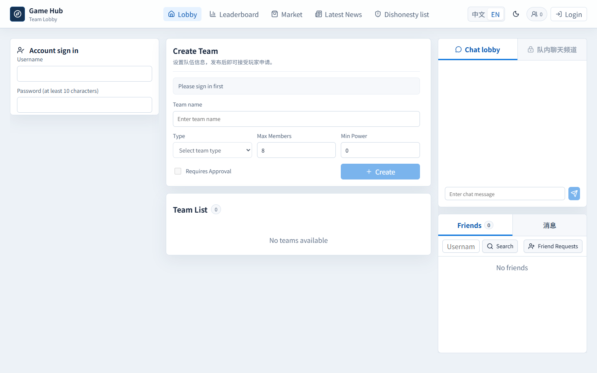
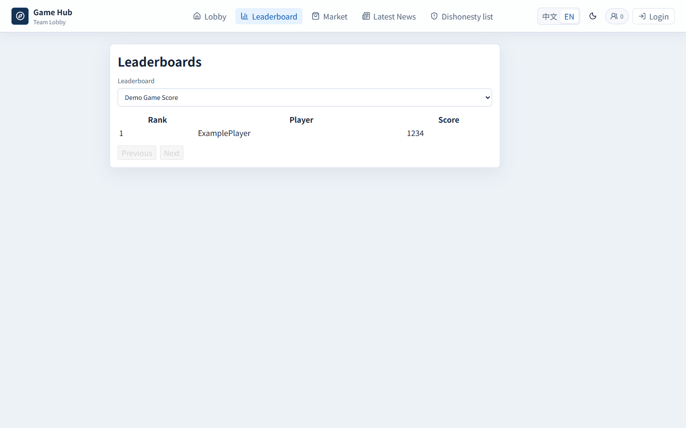
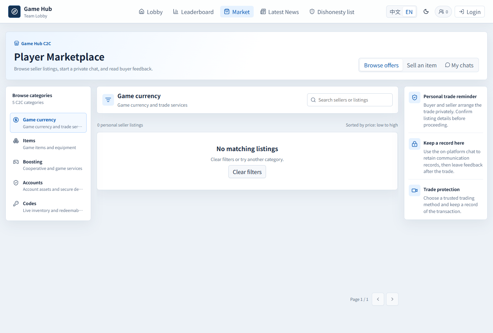
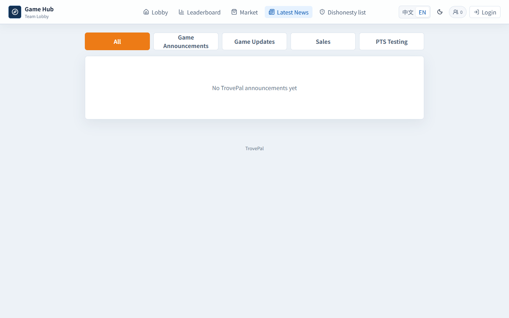
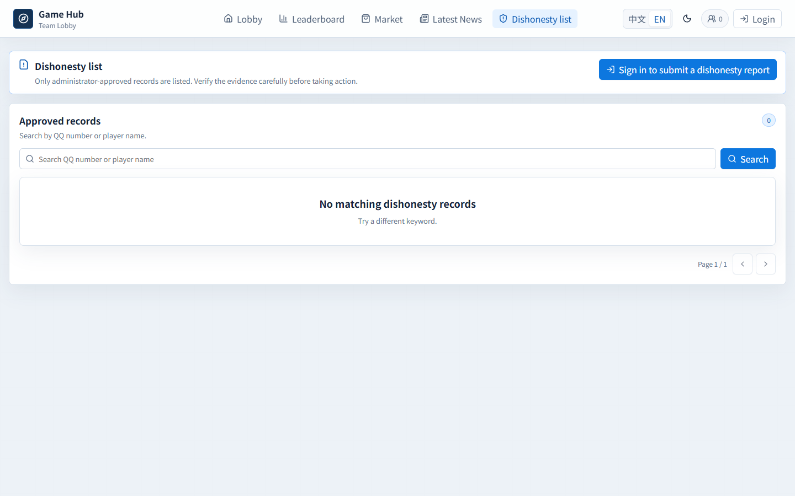
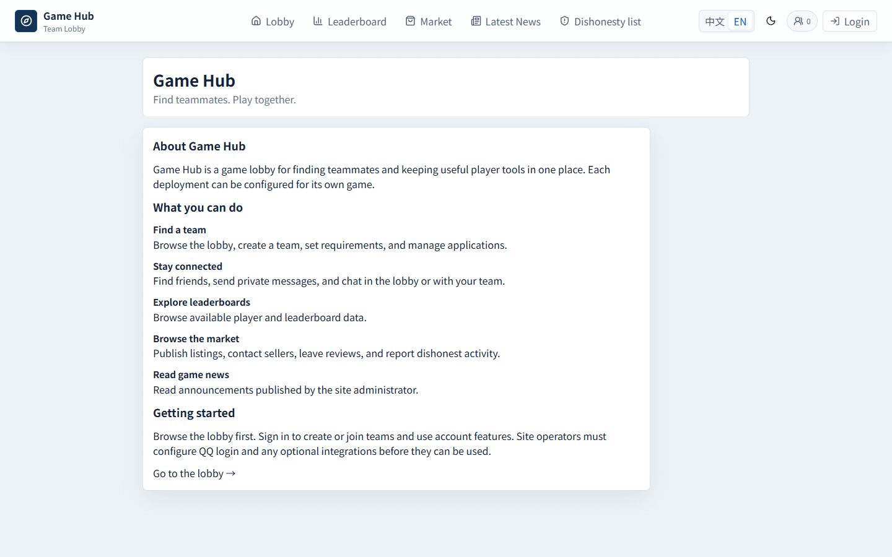
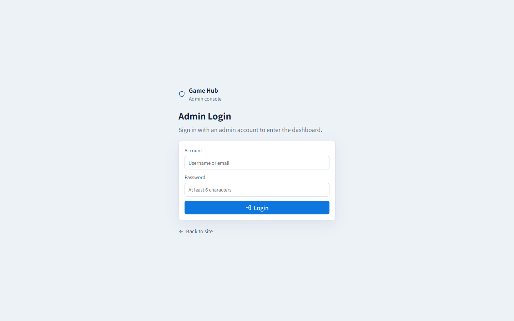
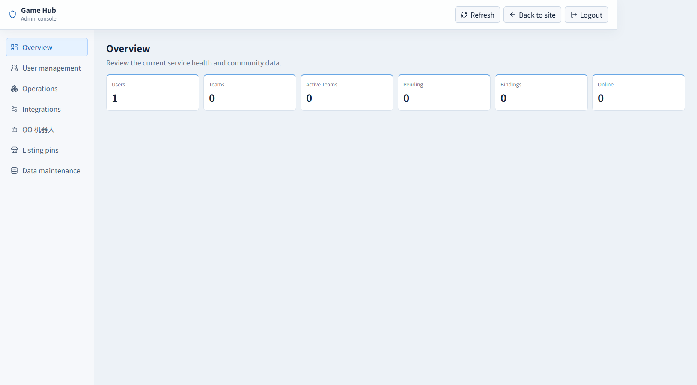
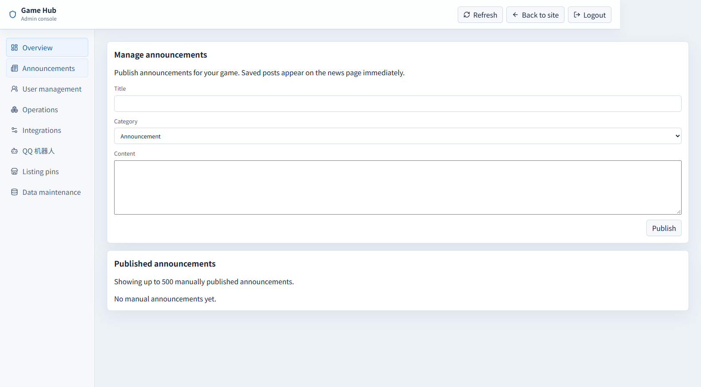

# Game Hub

[中文](README.md) | [中文](README.md)

Game Hub (formerly TroveBBS) is a team-finding lobby configurable for a single game. React, TypeScript and Vite frontend; Node.js, Express and PostgreSQL backend. Features include a team lobby, leaderboard, marketplace, profiles, social features and administration. Leaderboards can be populated from CSV or a compatible external collector.

[中文](README.md)

## Features

- **Team lobby:** browse and create teams, set requirements, manage applications, and use lobby or team chat.
- **Friends and messages:** search users, manage requests, exchange direct messages, and see online presence. Local accounts work without QQ; QQ OAuth is optional.
- **Leaderboards and profiles:** search rankings and bind a game character. Data must be uploaded by a compatible collector; the website does not collect it automatically.
- **Marketplace:** browse or publish listings, contact sellers, and read or submit reviews.
- **Dishonesty reports:** submit evidence and reports for administrator review.
- **News and QQ bot:** administrators publish announcements manually; QQ bot notifications are optional.
- **Administration:** manage users, teams, marketplace items, reports and integrations.

Each deployment serves one configured game; leaderboard collection requires a game-specific integration. The site does not currently provide a forum or post feed.

## Screenshots

These images were captured in an isolated local demo with sample data. Available data and features depend on your configuration. The interface supports Chinese, English, and light/dark themes.

### Team lobby

Browse teams and chat; sign in to create or join a team.



### Leaderboards

Browse and search rankings; the page is empty until data is imported.



### Marketplace

Browse categories and sign in to publish or contact a seller.



### News

Administrators can publish announcements directly.



### Dishonesty reports

Browse reviewed reports or sign in to submit one.



### About

Learn what the project does and what configuration it needs.



### Administration

Administrators sign in at `/admin` to use the dashboard. The demo contains no real user data.





Manage manually published announcements:



## Typical setup

1. Start the site using Docker below and set a unique administrator account and password.
2. Sign in at `/admin`; configure QQ OAuth, an image host or a QQ bot only if needed.
3. Users can register a local account on the home page, bind a game name, create or join teams, manage friends, chat and use the marketplace.
4. Import leaderboard CSV as described below, or use a collector compatible with the target game and upload API.

## Run with Docker

Install Docker and Docker Compose, then from this directory in PowerShell:

```powershell
Copy-Item .env.example .env
# Edit .env: replace POSTGRES_PASSWORD and USER_SESSION_SECRET.
# Set ADMIN_PASSWORD if an initial administrator is needed.
docker compose up -d --build
docker compose ps
Invoke-WebRequest http://127.0.0.1:8080/health -UseBasicParsing
```

The example configuration binds the frontend to `127.0.0.1:8080`; change `FRONTEND_BIND` and `FRONTEND_PORT` in `.env` as needed. First startup creates a PostgreSQL volume and applies ordered migrations. An empty `ADMIN_PASSWORD` does not create or update the initial administrator. Back up the database and uploads before upgrading an existing instance; do not run `docker compose down -v` to clean an existing deployment.

## Configuration and secrets

Copy `.env.example` to `.env` and edit the latter. The file is Git-ignored. Replace all placeholder credentials with independently generated long random values. Never put secrets into frontend `VITE_` variables: these are built into browser code.

| Variables | Purpose |
| --- | --- |
| `POSTGRES_DB`, `POSTGRES_USER`, `POSTGRES_PASSWORD` | Database name and credentials. Changing the password in `.env` on an existing volume also requires updating the database user. |
| `USER_SESSION_SECRET` | Independent long random secret for signing user sessions. Changing it may invalidate sessions. |
| `ADMIN_USERNAME`, `ADMIN_PASSWORD`, `ADMIN_EMAIL` | Initial admin; a password is required to create or update it. |
| `LEADERBOARD_COLLECTOR_TOKEN` | At least 32 random characters; enter the same value in the collector upload window. Empty disables collector endpoints. |
| `MARKET_CURRENCY` | Three-letter uppercase currency code for marketplace prices, default `CNY`, e.g. `USD`. Rebuild the frontend and restart the backend after changes. Existing prices are not converted. |
| `PUBLIC_BASE_URL`, `FRONTEND_BASE_URL` | Your public deployment URLs; replace examples. |
| `QQ_OAUTH_API_URL`, `QQ_OAUTH_APPID`, `QQ_OAUTH_APPKEY`, `QQ_OAUTH_CALLBACK_URL` | Your compatible QQ OAuth service URL, credentials and registered callback, e.g. `https://your-domain.example/api/auth/qq/callback`. The sample provider address is a placeholder. |
| `IMAGE_HOST_BASE_URL`, `IMAGE_HOST_API_KEY`, `IMAGE_HOST_REVIEW_FOLDER_ID` | Optional image host settings; the administration UI can also set these. The production Compose file currently requires configuration through the admin UI. |
| `QQ_BOT_APP_ID`, `QQ_BOT_APP_SECRET`, `QQ_BOT_TEAM_URL` | Optional QQ bot credentials and lobby URL. Subsequent admin UI settings take precedence. |
| `VITE_API_BASE_URL`, `VITE_WS_BASE_URL` | Optional build-time API/WebSocket origins. Same-origin proxy deployments normally leave these empty. Do not put secrets here. |

If your QQ bot platform requires an ownership-verification file, place your own `<application-id>.json` in `public/` according to the platform instructions. Do not reuse another site's application ID.

Admin integration settings can also be stored in PostgreSQL; the collector stores its token in SQLite. Do not publish databases, backups, `docker-data/`, uploaded files, logs or old Git history. If a credential was committed before, rotate it; deleting the current file does not remove it from history.

## Development and deployment

Use Node.js `^20.19.0` or `>=22.12.0` (Node 22 recommended):

```powershell
npm ci
npm ci --prefix server
npm run build
npm --prefix server test
docker compose config --quiet
docker compose -f docker-compose.prod.yml config --quiet
```

`npm run dev` starts Vite on port 5173 and the backend on port 3000. The backend requires PostgreSQL and environment variables; direct execution does not automatically load `.env`. Use Docker above or supply environment variables to the process.

Public endpoints are `/api`, `/health`, `/uploads` and WebSocket `/ws`. For a public deployment, configure HTTPS and a reverse proxy that forwards these paths and WebSocket connections. Production Compose binds to local port 8080 by default. Replace `example.com` in `index.html`, `public/robots.txt` and `public/sitemap.xml` with your own domain. See [architecture](ARCHITECTURE.md) and [developer notes](docs/ai/). The original automated deployment workflow is not included in this cleaned copy.

Administrators can publish, edit and delete manual announcements under `/admin` → Announcements. Previously imported announcements are retained; TrovePal synchronization is no longer supported.

## Single-game configuration

- Set `VITE_GAME_NAME` in `.env` to display your game name in the header. Rebuild the frontend with `docker compose up -d --build frontend` after changing it.
- Optionally set `GAME_TEAM_TYPES` to a JSON array, for example `GAME_TEAM_TYPES=[{"id":"raid","zh":"副本","en":"Raid"}]`. Each item needs a unique id and Chinese and English labels. Recreate the backend after changes. Configured types are inserted or their translated labels updated. Other existing types and teams remain in the database but are excluded from the new-team selector.
- Import leaderboard CSV using the tool below. Automatic game data collection still needs a collector for that game. Existing data and tables are retained.

Trove users can also use the separate [Trove leaderboard mod and collector](https://github.com/moligod/trove-leaderboard-collector); the website does not require it.

## Local accounts and leaderboard CSV import

On the home page, create an account with a username of 3–32 letters, numbers, underscores or hyphens and a password of at least 10 characters. Passwords use salted scrypt hashes. Local and QQ accounts are separate; administrators still sign in at `/admin`. Self-service password recovery and account linking are not implemented, so operators need their own recovery procedure. Login and registration are rate-limited per source IP within each backend process. Public deployments should use HTTPS, a trusted reverse proxy, and additional rate limits appropriate to their traffic.

The generic importer uploads data; it does not collect it from games. Prepare a UTF-8 CSV following the [example](scripts/leaderboard-example.csv), with columns `leaderboard_id,leaderboard_name,rank,player_name,score`. Each row represents a player; all fields are required, rank must be a positive integer, and a board ID must use the same name throughout. Python 3 is required.

1. Set `LEADERBOARD_COLLECTOR_TOKEN` in the website `.env` to at least 32 random characters and restart the backend.
2. Obtain complete rankings for the game and format them as CSV.
3. In the importer's terminal, set the URL and the same secret, then run:

```powershell
$env:GAME_HUB_URL = 'http://127.0.0.1:8080'
$env:LEADERBOARD_COLLECTOR_TOKEN = '<same secret as website .env>'
python scripts/import_leaderboard.py scripts/leaderboard-example.csv
# Optional: add --date 2026-10-28 to specify the source date
```

Use HTTPS for remote URLs and keep secrets and private CSV data out of Git. Each successful publication is a **complete snapshot**: the CSV must contain every board intended to remain current. A failed import does not publish an incomplete snapshot.
