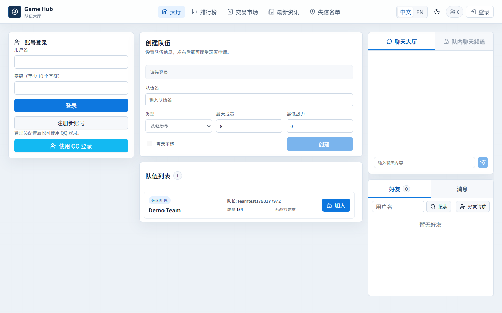
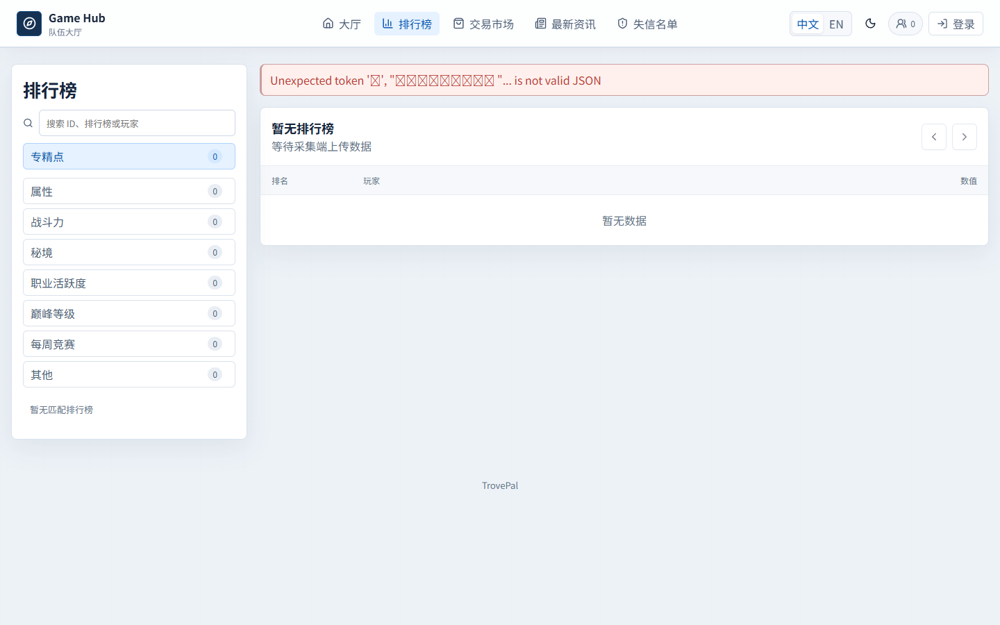
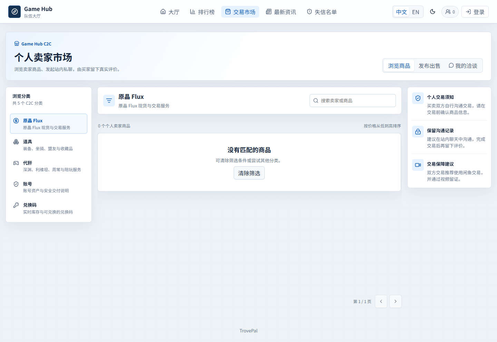
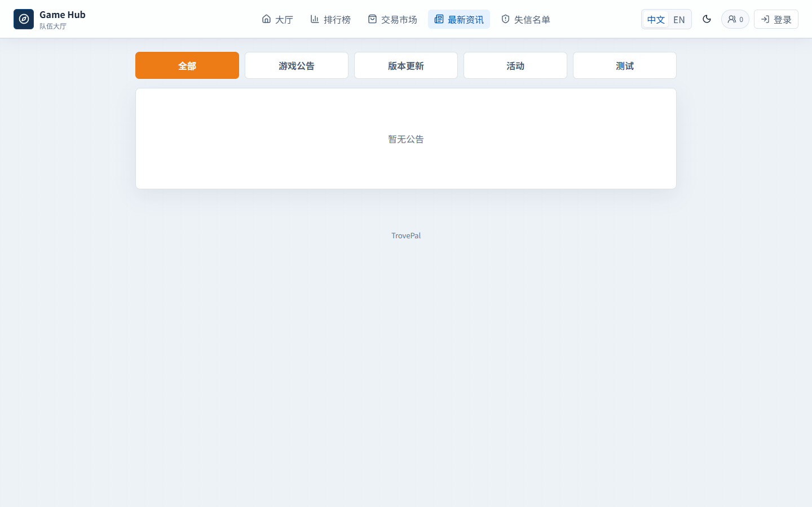
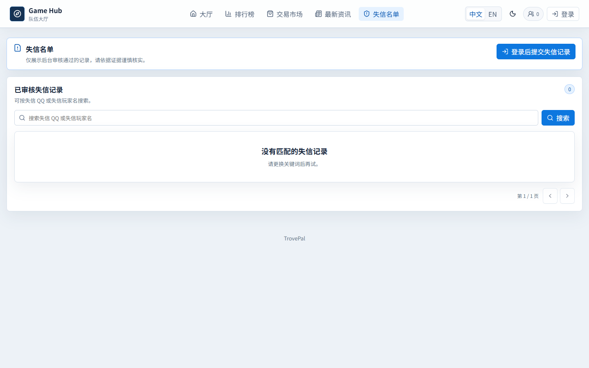
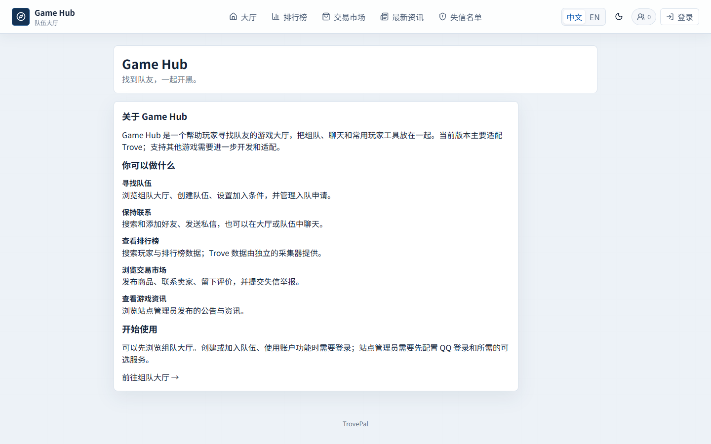
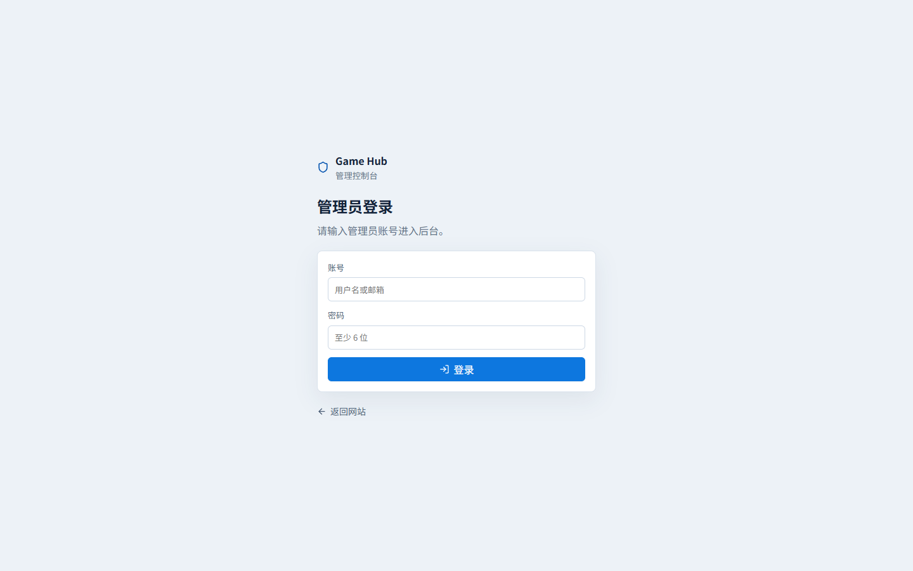
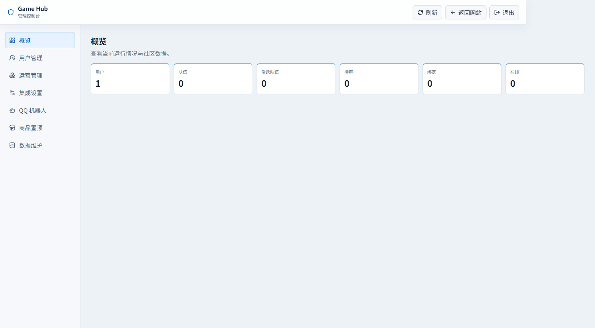
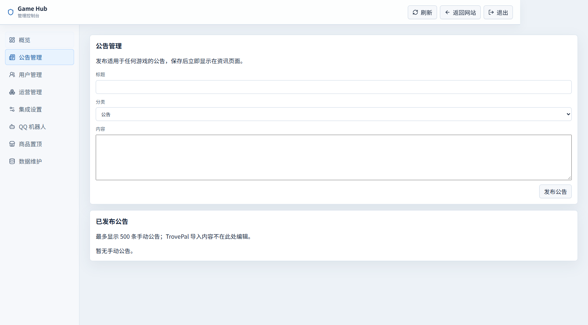

# Game Hub

Game Hub（原 TroveBBS）是一个游戏组队大厅，目前以 Trove 为主要适配游戏，提供组队大厅、排行榜、交易、玩家资料、社交及管理功能。前端为 React、TypeScript 和 Vite，后端为 Node.js、Express 和 PostgreSQL；排行榜数据由配套采集器提供。

[English](README.en.md)

## 功能介绍

- **组队大厅**：浏览队伍、创建队伍、设置条件、处理入队申请，并通过大厅和队伍聊天沟通。
- **好友与私信**：搜索用户、管理好友请求、发送私信和查看在线状态。登录功能需要先配置 QQ OAuth。
- **排行榜与玩家资料**：查询榜单及玩家数据，支持绑定游戏角色。Trove 排行榜数据由单独的 MOD 和采集器采集上传；网站本身不会自动采集。
- **交易市场**：浏览或发布商品、站内联系卖家、查看和提交评价。
- **失信名单**：提交证据和举报，经管理员审核后展示。
- **资讯与机器人**：管理员可在后台手动发布、编辑和删除公告；QQ 机器人为可选集成。
- **管理后台**：管理用户、队伍、市场、举报及外部服务配置。

当前适配 Trove 的数据和业务；接入其他游戏需要开发适配。站点不提供论坛发帖功能。

## 界面预览

以下截图来自独立的本地演示环境，使用空数据库；上线后数据和可用功能取决于实际配置。页面提供中文和英文，支持明暗主题。

### 组队大厅

浏览队伍和聊天，登录后可创建或加入队伍。



### 排行榜

按榜单查看或搜索数据；导入数据前显示空状态。



### 交易市场

按类别浏览商品，登录后发布商品或联系卖家。



### 游戏资讯

查看管理员发布的公告；可选配置 TrovePal 导入数据。



### 失信名单

查看已审核的举报，登录后可提交举报。



### 关于

了解项目用途、主要功能和使用前提。



### 管理后台

管理员在 `/admin` 登录后可进入管理控制台。演示画面不包含真实用户数据。





公告管理支持手动发布、编辑和删除：



## 使用流程

1. 按下方 Docker 步骤启动网站，并设置独立的管理员账号和密码。
2. 打开 `/admin` 登录，在集成设置中配置自己的 QQ OAuth；需要资讯、图床或机器人时，再分别配置相应服务。
3. 普通用户通过 QQ 登录后，可以创建或申请加入队伍、管理好友、聊天和使用交易功能。
4. 如需 Trove 排行榜，安装并使用单独的采集器，按其说明填写本站上传地址及相同的采集令牌。

## 快速启动（Docker）

需要 Docker 和 Docker Compose。以下命令在本目录执行：

```powershell
Copy-Item .env.example .env
# 编辑 .env：至少更换 POSTGRES_PASSWORD、USER_SESSION_SECRET；需要后台时设置 ADMIN_PASSWORD
# 需要排行榜上传时，再设置 LEADERBOARD_COLLECTOR_TOKEN
docker compose up -d --build
docker compose ps
Invoke-WebRequest http://127.0.0.1:8080/health -UseBasicParsing
```

`.env.example` 默认前端端口为 8080，地址是 `http://127.0.0.1:8080`；可在 `.env` 中修改 `FRONTEND_PORT`。首次启动会建立 PostgreSQL 数据卷并执行有序迁移。管理员密码为空时不会创建或更新初始化管理员。更新已有部署前先备份数据库和上传目录；不要用 `docker compose down -v` 清理已有数据。

## 配置与敏感信息

复制 `.env.example` 为同目录 `.env`，只在 `.env` 填自己的值。`.env` 已被 Git 忽略，不要提交、截图或分享。部署使用独立强随机值，切勿使用模板中的占位密码。

| 配置项 | 用途与填写位置 |
| --- | --- |
| `POSTGRES_DB`, `POSTGRES_USER`, `POSTGRES_PASSWORD` | 数据库名称、账号和密码；新建数据库时填写。已有数据卷修改密码需同步修改数据库账号。 |
| `USER_SESSION_SECRET` | 普通用户会话签名密钥，填写独立的长随机字符串。变更后已有会话可能失效。 |
| `ADMIN_USERNAME`, `ADMIN_PASSWORD`, `ADMIN_EMAIL` | 初始化管理员；设置密码才会创建或更新。 |
| `LEADERBOARD_COLLECTOR_TOKEN` | 排行榜上传密钥，至少 32 个随机字符；在采集器“上传数据”中填入相同值。留空时上传接口关闭。 |
| `PUBLIC_BASE_URL`, `FRONTEND_BASE_URL` | 自己部署的公开地址；上线后替换示例域名。 |
| `QQ_OAUTH_API_URL`, `QQ_OAUTH_APPID`, `QQ_OAUTH_APPKEY`, `QQ_OAUTH_CALLBACK_URL` | 自己使用的兼容 QQ OAuth 服务地址、应用凭据及回调；回调示例为 `https://你的域名/api/auth/qq/callback`，还需在提供方登记。示例地址仅为占位符。 |
| `TROVEPAL_API_KEY`, `TROVEPAL_APP_NAME` | 可选公告接口凭据及绑定的应用名。 |
| `IMAGE_HOST_BASE_URL`, `IMAGE_HOST_API_KEY`, `IMAGE_HOST_REVIEW_FOLDER_ID` | 可选图床地址、密钥和审核目录；也可在管理后台配置。生产 Compose 当前需通过后台配置图床。 |
| `QQ_BOT_APP_ID`, `QQ_BOT_APP_SECRET`, `QQ_BOT_TEAM_URL` | 可选 QQ 机器人凭据和组队链接；后台后续保存的配置优先。 |
| `VITE_API_BASE_URL`, `VITE_WS_BASE_URL` | 前端构建时的 API/WebSocket 地址；同域反向代理通常留空。这些值会进入浏览器，不能放密钥。 |

管理员集成设置可能保存在 PostgreSQL，采集器配置和密钥保存在其 SQLite 文件；数据库、备份、`docker-data/`、上传文件、日志及 Git 历史均可能包含敏感信息，不能公开。若凭据曾经进入仓库历史，删除当前文件并不能撤销泄露，应轮换凭据并检查历史。本整理版没有包含原仓库 Git 历史。

## 本地开发

Node.js 要求 `^20.19.0` 或 `>=22.12.0`，建议使用 Node.js 22。安装前后端依赖：

```powershell
npm ci
npm ci --prefix server
```

后端需要可访问的 PostgreSQL 和环境变量；直接运行 `npm run dev` 不会自动读取 `.env`，需在当前进程提供对应环境变量，或使用上面的 Docker 方式。前端开发端口为 5173，后端默认 3000。常用检查：

```powershell
npm run build
npm --prefix server test
docker compose config --quiet
docker compose -f docker-compose.prod.yml config --quiet
```

API 位于 `/api`，健康检查为 `/health`，WebSocket 为 `/ws`，上传文件位于 `/uploads`。部署到公网需自行配置 HTTPS 和反向代理，并转发这些路径及 WebSocket；生产 Compose 默认绑定本机 8080。`.env.example` 中的第三方服务地址为示例，须替换为自己的配置；发布时还需将 `index.html`、`public/robots.txt`、`public/sitemap.xml` 中的 `example.com` 替换为自己的域名。

架构说明见 [ARCHITECTURE.md](ARCHITECTURE.md) 和 [docs/ai](docs/ai/)。本整理版没有启用原项目的自动部署工作流，请自行配置 CI/CD。

如 QQ 机器人平台要求在站点提供应用归属验证文件，按平台要求将自己的 `<应用ID>.json` 放入 `public/`；不要使用其他站点的应用 ID。

[English documentation](README.en.md)

管理员登录 `/admin` 后选择“公告管理”，可发布、编辑和删除手动公告。TrovePal 自动同步默认关闭；需要时在 `.env` 设置 `TROVEPAL_ENABLED=true` 并配置密钥和应用名，重新创建后端容器。原有 TrovePal 公告不会被删除。
